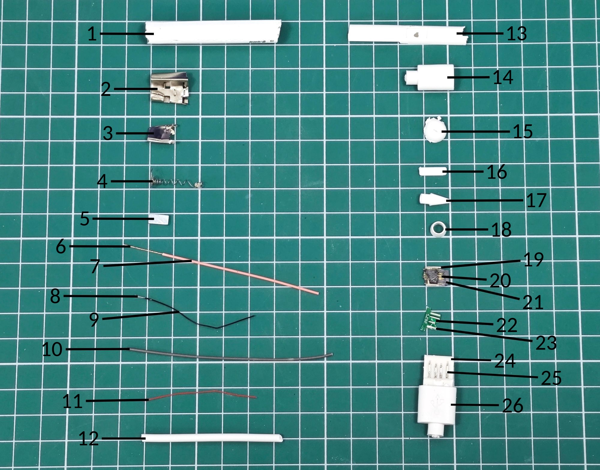

# Нумерация фото (NumberPhoto)

Программа для Windows, которая сама расставляет номера деталей на фото у концов
чёрных линий‑выносок.



## Скачать

**[NumberPhoto.exe](NumberPhoto.exe)** — один файл, установка не нужна
(Windows 10/11, 64‑бит). Откройте ссылку и нажмите «Download raw file».

Файл не подписан цифровой подписью, поэтому SmartScreen может предупредить
при первом запуске: «Подробнее» → «Выполнить в любом случае».

## Как пользоваться

1. Нарисуйте на фото чёрные прямые линии (как обычно): один конец на детали,
   другой — на свободном фоне, там, где должен стоять номер.
2. Откройте фото в программе: кнопка «Открыть фото…», `Ctrl+V` (вставить
   картинку или скопированный файл из буфера обмена) или перетащите файл в окно.
3. В поле **«Начать с числа»** укажите первый номер.
4. Проверьте результат и нажмите «Сохранить как…» (`Ctrl+S`) или «Копировать
   в буфер» (`Ctrl+C`). По умолчанию файл сохраняется рядом с исходным как
   `имя_num.jpg`.

### Как ставятся числа

- Все числа одного размера и одного шрифта. По умолчанию Calibri, как на
  примере; если его нет, используется встроенный Carlito той же формы. Шрифт
  можно выбрать в списке.
- Число стоит на продолжении линии, линия указывает ровно в середину числа.
  Отступ от конца линии — четверть высоты цифр.
- Номер ставится у свободного конца линии, то есть у того, что лежит на фоне,
  а не на детали.
- Размер подбирается автоматически (около 2,8 % от размера фото) и
  уменьшается, если иначе числа налезли бы друг на друга, на линии или на
  край фото. Если число задевает деталь, оно немного отодвигается вдоль своей
  линии. Размер можно задать вручную, сняв галочку «Подбирать размер
  автоматически»: тогда на всех фото серии он будет одинаковым.
- **Порядок «Авто»**: ряды чисел над и под деталями нумеруются слева направо,
  столбцы слева и справа от деталей — сверху вниз, а сами ряды и столбцы идут
  сверху вниз и слева направо. Есть также режимы «Строками» и «Столбцами».

### Ручная правка

| Действие | Как сделать |
|---|---|
| Сдвинуть число вдоль линии | перетащить его мышью |
| Удалить число | правый щелчок по числу → «Удалить», или навести курсор и нажать `Delete` |
| Поставить число на другой конец линии | правый щелчок → «Перенести число на другой конец линии» |
| Изменить порядок | правый щелчок → «Задать номер этого числа…» (остальные сдвинутся) |
| Добавить число к линии, которую программа пропустила | щёлкнуть по линии |
| Отменить | `Ctrl+Z` |
| Масштаб / прокрутка | колесо мыши / перетаскивание фона, `Ctrl+0` — по размеру окна |

### Серия фото

Если включено «Следующее фото продолжит нумерацию», то после сохранения
следующее открытое фото начнётся с номера, следующего за последним
(например, первое фото 1–68, второе 69–110). Настройки запоминаются между
запусками.

### Командная строка

```
NumberPhoto.exe -cli -start 69 фото.jpg результат.jpg
```

Параметры: `-start N`, `-order auto|rows|cols`, `-size N` (высота цифр в
пикселях, 0 — автоматически), `-font Calibri` (имя или путь к `.ttf`),
`-debug` (сохранить картинки с найденными линиями).

## Требования к линиям

- Цвет — чёрный (как на примерах). Тёмные тени и тёмно‑серые детали
  программа отличает от нарисованных линий.
- Линии прямые и одной толщины. Линия может проходить по тёмным деталям,
  касаться их и начинаться на чёрной микросхеме.

## Сборка из исходников

Нужен [Go](https://go.dev/dl/) 1.22 или новее; компилятор C не нужен.

```
./build.sh      # Linux / macOS / Git Bash
build.bat       # Windows
```

Структура:

- `core/` — поиск линий, выбор свободного конца, размещение и порядок чисел,
  отрисовка шрифтом (не зависит от Windows, покрыто тестами: `go test ./core`);
- `gui_windows.go`, `winapi_windows.go` — окно программы (библиотека
  [walk](https://github.com/lxn/walk)), буфер обмена;
- `cli.go` — режим командной строки;
- `res/` — значок и манифест; `testdata/` — фото для тестов.

Встроенный шрифт Carlito распространяется по лицензии SIL Open Font License
(`core/fonts/OFL-Carlito.txt`).
